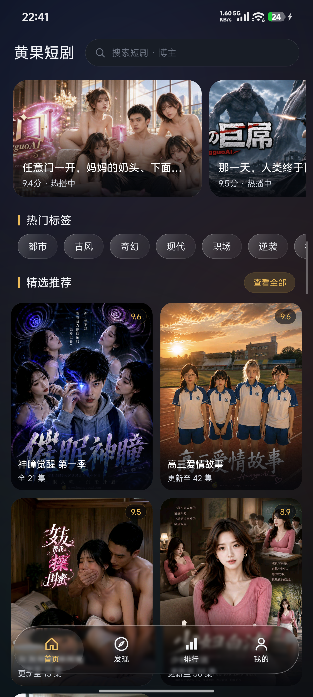
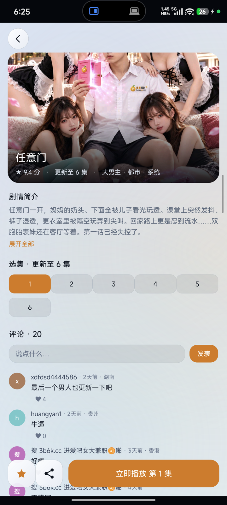
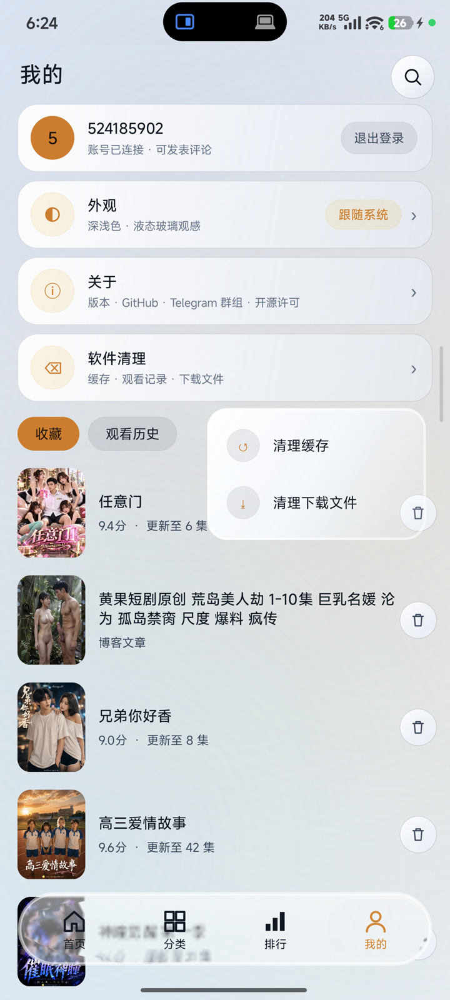
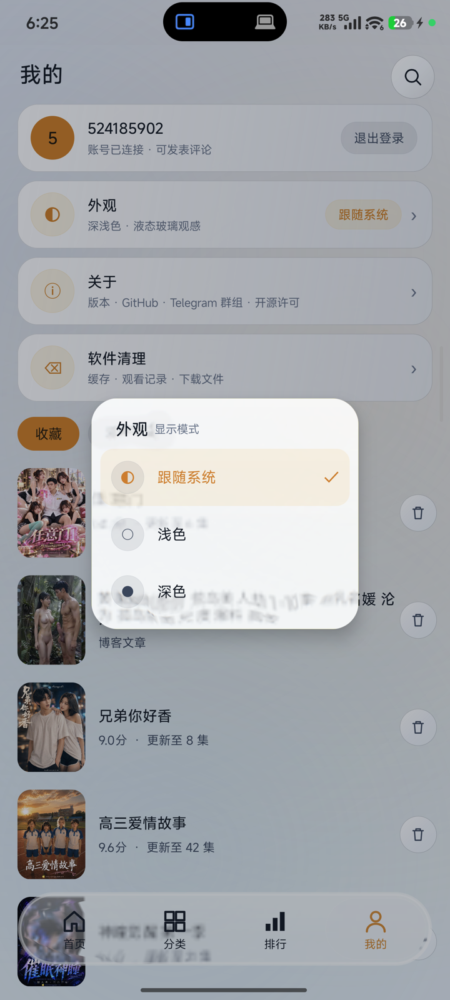
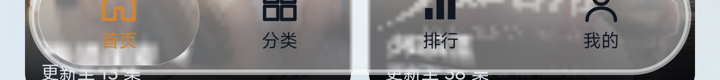
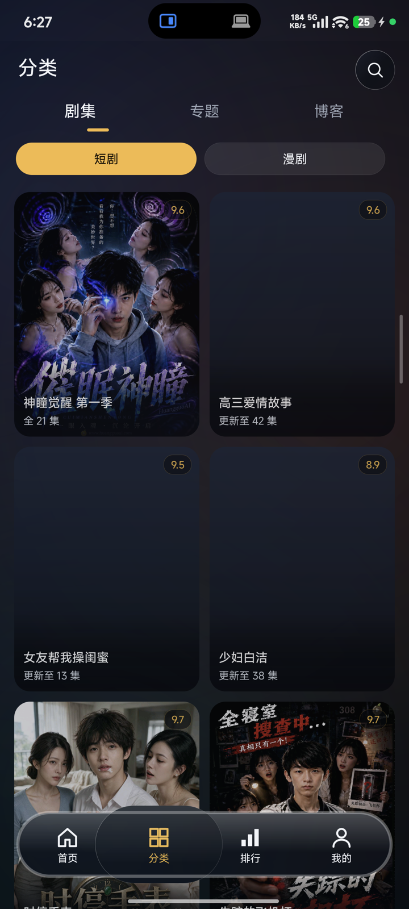
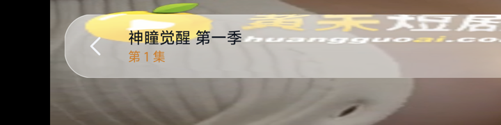

<div align="center">

# 黄果短剧 · Huangguo Pure

**一款以「液态玻璃」为设计语言的第三方短剧客户端**

原生 Android · Kotlin-free 纯 Java · 无广告 · 无推荐算法 · 双主题全适配

[](https://github.com/Zihium/Huangguo-Pure/releases)
[](LICENSE)
[]()
[]()

</div>

---

## 简介

Huangguo Pure 是一个第三方短剧聚合播放客户端。整个 App 围绕一套自研的 **Liquid Glass（液态玻璃）** 视觉体系构建：真实的背景采样、边缘 RGB 色散折射、按压凸起物理动效，配合深浅双主题的全量手工适配。功能上覆盖浏览、搜索、播放、下载、收藏、评论、专题、博客、排行榜的完整闭环。

## 截图预览

| 首页（浅色） | 详情页 | 专题页 |
|:---:|:---:|:---:|
|  |  |  |

| 我的（浅色） | 清理弹窗（液态玻璃） | 主题切换菜单 |
|:---:|:---:|:---:|
|  |  |  |

| Dock 玻璃容器 | 按压色散折射 | 播放器顶栏（视频帧折射） | 播放器底栏 |
|:---:|:---:|:---:|:---:|
|  |  |  |  |

## 核心特色

### 🔷 自研 Liquid Glass 液态玻璃引擎

不是「圆角 + 半透明」的仿真，而是一套完整的光学模拟：

- **背景实时采样**：玻璃控件对身后内容做真实像素采样，滚动时折射内容随之流动
- **RGB 三通道色散**：按压 Dock 栏时，玻璃容器边缘出现真实的彩虹色散——红/绿/蓝三套 mesh 顶点沿法线分离，再以 `MULTIPLY` 提取单通道 + `ADD` 叠加合成，中心区域零形变、精确还原原色
- **按压物理动效**：按下时胶囊凸起放大、色散增强，抬起回弹，全程容器高光边缘可见
- **播放器真玻璃**：播放器顶栏/底栏每 300ms 采样视频帧（`TextureView.getBitmap`），裁剪出面板对应区域喂给玻璃引擎——玻璃里透出的是正在播放的画面折射

### 🌗 深 / 浅双主题全量手工适配

- 一键切换，全 App 每一个控件（页面文字、玻璃面板、弹窗菜单、进度条、chip、输入框、滚动条）均为主题感知
- 压在海报/封面 scrim 上的文字恒白，页面文字随主题，两套配色互不干扰
- 浅色主题强调色为高饱和琥珀金（`#D97706`），Dock 选中、按钮、高亮统一取色

### 🎬 全手势播放器

| 手势 | 功能 |
|---|---|
| 双击左 / 右 1/3 画面 | 后退 / 快进 10 秒（带画面提示 + 震动反馈） |
| 双击中间 | 暂停 / 播放 |
| 左右横滑画面 | 拖动进度（低灵敏度，带时间预览提示） |
| 长按画面 | 2.0x 倍速加速 |
| 长按 + 上滑 | 锁定倍速；下滑恢复 |
| 单击中间 | 显示 / 隐藏控制层 |
| 底栏「画面」按钮 | 自适应原比例（letterbox） / 铺满全屏 / 强制 16:9 / 强制 4:3 |

- 视频默认**自适应原比例**显示，不强制拉伸，黑底居中
- 倍速菜单：0.5x ~ 3.0x 六档，液态玻璃弹出面板
- 断点续播：退出后从历史位置继续，逐集记忆
- 音频焦点 / 插耳机自动暂停（`handleAudioBecomingNoisy`）

### 📥 完整的下载体系

- HLS 流逐段下载，实时进度百分比写在按钮上
- 按「剧名」归档到 `Download/Huangguo/<剧名>/`
- 下载管理：批量勾选删除，文件大小统计

### 🗂 内容与社区功能

- **首页**：精选推荐、焦点 Banner、分类横滑、最近在看（带续播进度）
- **分类**：剧集 / 专题 / 博客三大段，剧集段带短剧 / 漫剧三级分类
- **专题**：专题专辑聚合页 + 详情页剧集列表
- **博客**：图文文章正文（富文本渲染）+ 评论区
- **排行榜**：热播榜 / 推荐榜 / 上升榜，热度指数可视化
- **搜索**：关键字实时搜索
- **评论**：详情页与博客文章的评论区，匿名头像取昵称首字着色
- **收藏 / 历史**：混合收藏（剧 / 文章 / 专题）、观看历史续播，滑动删除（液态玻璃圆钮）
- **图片查看器**：博客配图全屏缩放查看、一键保存到相册
- **清理工具**：缓存清理 + 下载文件管理，液态玻璃弹窗

### ↔ 一体化滑动导航

一级页面（首页 → 分类 → 排行 → 我的）左右滑动直达；分类页内部的二级 / 三级分类滑到边界后继续滑动，自动接续切换到相邻一级页面——整 App 像一条连续的横向胶卷。

## 技术栈

| 项 | 实现 |
|---|---|
| 语言 | Java（全项目 46 个类，无 Kotlin） |
| 播放内核 | Media3 / ExoPlayer（HLS） |
| 最低支持 | Android 7.0（API 24） |
| UI | 纯代码构建，无 XML 布局依赖 |
| 玻璃引擎 | 自研 `LiquidGlassDrawable`（BitmapMesh 折射 + 三通道色散 + 法线高光 rim） |
| 本地存储 | SQLite（收藏 / 历史 / 点赞，含版本迁移） |
| 体积 | APK 约 1.4MB，无混淆依赖膨胀 |

## 构建

```bash
# 1. 用 Android Studio 打开项目，或命令行：
./gradlew assembleDebug

# 2. Release 签名：在本地 gradle.properties 配置（不要提交到仓库）：
# HG_STORE_FILE=../keystore/your.jks
# HG_STORE_PASS=xxx
# HG_KEY_ALIAS=xxx
# HG_KEY_PASS=xxx
./gradlew assembleRelease
```

## 目录结构

```
app/src/main/java/com/huangguo/pure/
├── MainActivity / HomePage / CategoryPage / RankPage / MinePage   # 一级页面
├── DetailActivity / TopicActivity / TopicPage / PostActivity      # 二级页面
├── SearchPage / AboutActivity / ImageViewerActivity               # 辅助页面
├── PlayerActivity                                                  # 全手势播放器
├── GlassDock / LiquidGlassDrawable / GlassDrawable / GlassSurface  # 液态玻璃引擎
├── GlassMenu / PullRefresh / Ui / Theme                            # 通用组件
├── Store / Api / HlsDownloader / MediaSave / CleanHelper           # 数据与下载
└── CommentBox / HtmlRich / PosterCard / FeedAdapter / PagedGrid    # 内容组件
```

## License

[MIT](LICENSE) © 2026 Zihium
