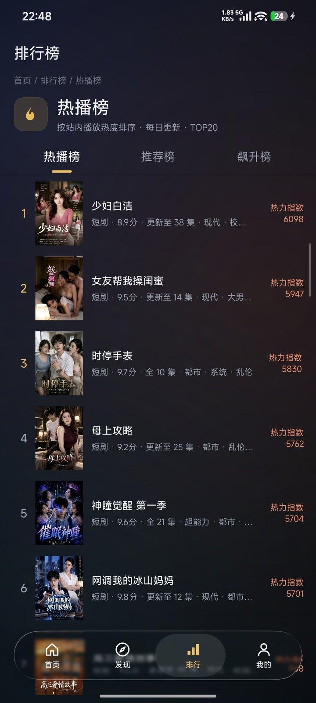
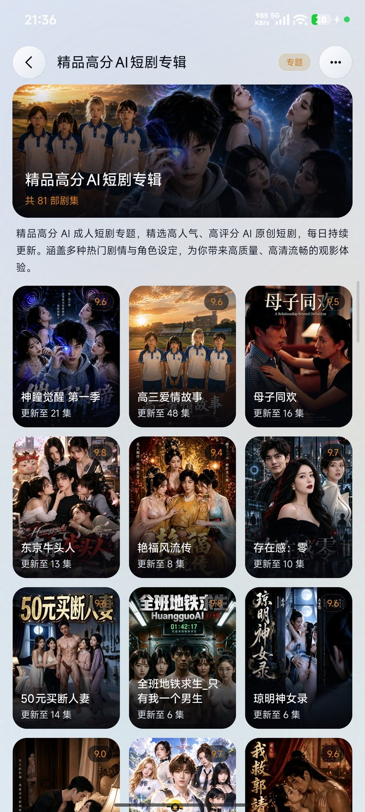
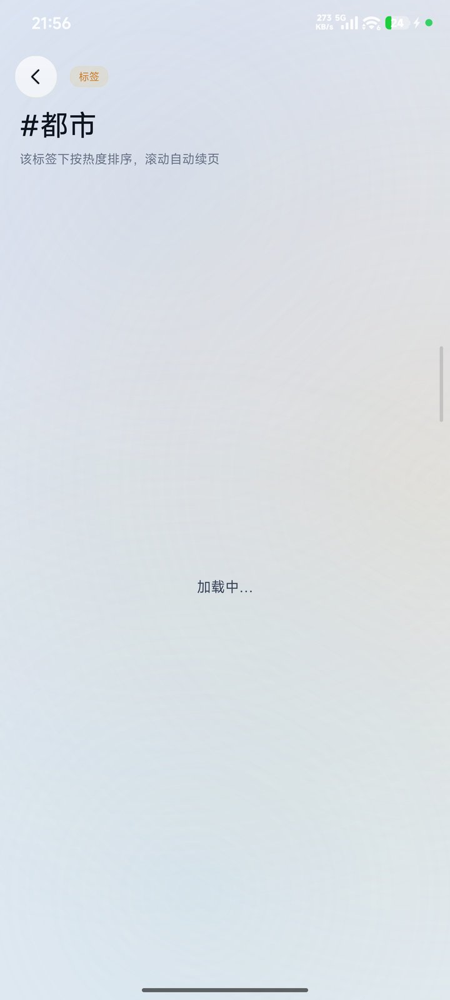
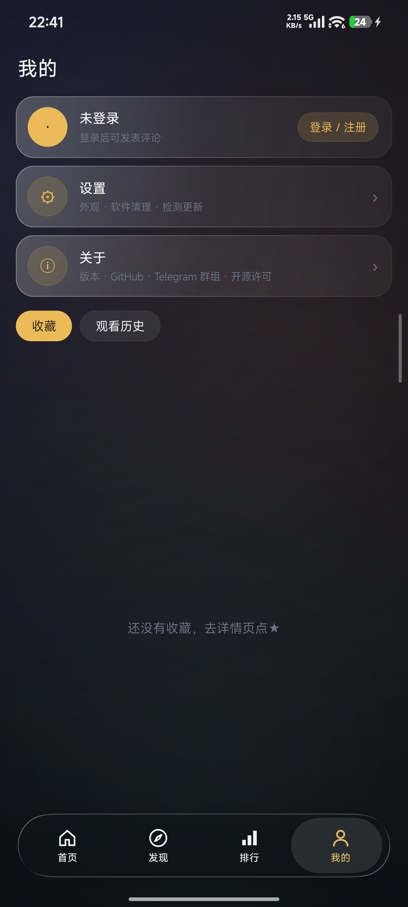
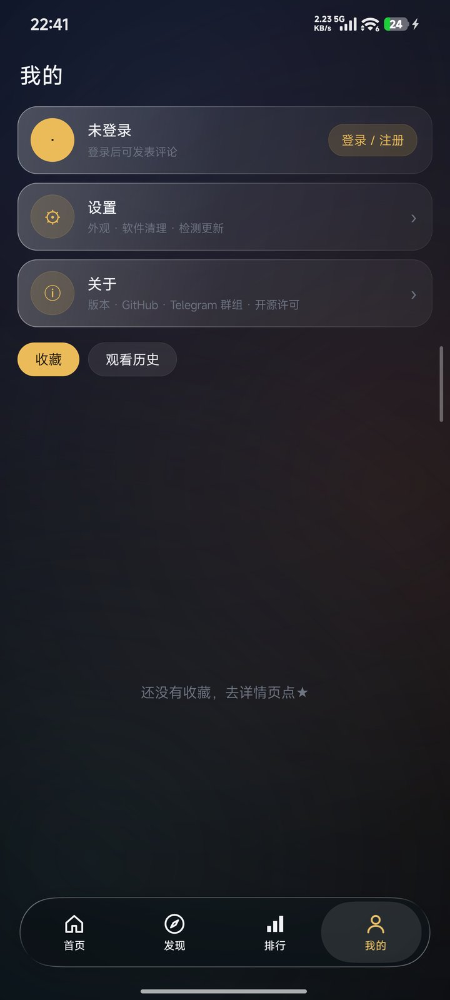
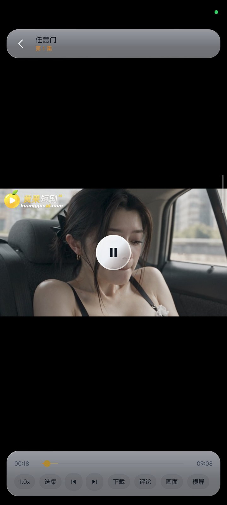
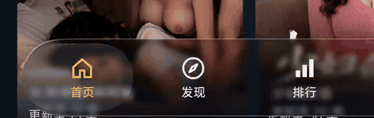

<div align="center">

# 黄果短剧 · Huangguo Pure

**一款以「液态玻璃」为设计语言的第三方短剧客户端**

原生 Android · 无广告 · 无推荐算法 · 深 / 浅双主题全适配

[](https://github.com/Zihium/Huangguo-Pure/releases)
[](LICENSE)
[]()
[]()

</div>

---

## 简介

Huangguo Pure 是一个第三方短剧聚合播放客户端，围绕液态玻璃视觉体系构建：玻璃控件对身后内容做真实像素采样，边缘折射、按压形变、拖动时光纹跟随手指变化。功能上覆盖浏览、搜索、播放、下载、收藏、评论、专题、博客、排行榜，并带检测更新、多线路切换等自维护能力。

v1.1.0 起，底部 Dock 玻璃栏基于 Kyant0/AndroidLiquidGlass（Compose）重建：按压时玻璃胶囊放大越出栏体，栏体边框被折射进胶囊内部，光纹随手指方向和速度变形——下面有动图。

## 截图预览 · 浅色模式

| 首页 | 发现 | 排行榜 |
|:---:|:---:|:---:|
|  |  |  |

| 专题详情 | 标签页 | 我的 |
|:---:|:---:|:---:|
|  |  |  |

| 设置 | 播放器竖屏 | 播放器横屏 |
|:---:|:---:|:---:|
|  |  |  |

## 液态玻璃 Dock（核心）

Dock 是整个 App 的视觉中心，也是按压 / 拖动交互最重的一块。按压时玻璃胶囊放大到 78dp，上下各越出 64dp 栏体 7dp；胶囊内部能看见被折射掰弯的栏体边框；横向拖动跟手，松手吸附；光纹（高光）的角度跟着手指落点走，拖动速度越快折射越深、色散越宽；图标强调色跟着指示器实时位置切换，手指把胶囊拖离当前页面时，原页面图标立即回到未选中态。



工作方式：页面全是原生 View（RecyclerView 等），Compose 的 `layerBackdrop` 采不到，所以 Java 侧把玻璃所在矩形从原生视图树里截成位图（3 倍降采样 + 自适应节流，滚动 / 惯性滑行 / 切页 / 启动四个窗口逐帧续采），Compose 侧把它画进 `rememberCanvasBackdrop`，再由 backdrop 库做 vibrancy / blur / lens / 色散。触摸、抬手惯性、切页、启动各有一段逐帧采样窗口，保证玻璃里的背景逐帧跟着画面走，而不是定格在某一张截图上。

## 深色模式

外观支持三态：跟随系统 / 浅色 / 深色。选「跟随系统」时，系统切换深浅色，应用在**当前页面原地换色**——停在哪个页面就换哪个页面，不会跳回首页；专题、标签、详情、播放器等二级页面同样生效。

深色不是简单反色：玻璃 tint、描边、文字、chip、进度条、玻璃面板各自有一套独立取值；压在海报 scrim 上的标题、简介保持恒白；Dock 的容器色、指示器着色、图标基础色也随主题切换。

| 深色首页 | 深色我的 |
|:---:|:---:|
|  |  |

## 全手势播放器

| 手势 | 功能 |
|---|---|
| 双击左 / 右 1/3 画面 | 后退 / 快进 10 秒（带画面提示 + 震动反馈） |
| 双击中间 | 暂停 / 播放 |
| 左右横滑画面 | 拖动进度（低灵敏度，带时间预览） |
| 长按画面 | 2.0x 倍速加速 |
| 长按 + 上滑 | 锁定倍速；下滑恢复 |
| 单击中间 | 显示 / 隐藏控制层 |
| 底栏「画面」按钮 | 自适应原比例 / 铺满全屏 / 强制 16:9 / 强制 4:3 |

- 视频默认自适应原比例，不强制拉伸，黑底居中
- 倍速菜单 0.5x ~ 3.0x 六档，液态玻璃弹出面板
- 播放器顶栏 / 底栏是「真玻璃」：每 300ms 从 `TextureView` 取一帧视频画面，裁出面板对应区域喂给玻璃引擎——玻璃里透出的是正在播放内容的折射
- 竖屏时控制条是悬浮玻璃卡片；横屏时顶栏与底部控制条铺满屏宽（左右零边距、直角贴边），选集 / 下载 / 评论 / 画面设置 / 横屏一条排开
- 断点续播，逐集记忆；音频焦点 / 插耳机自动暂停

## 设置中心

「我的」页的设置入口进入，全部用液态玻璃面板与菜单：

- **外观**：跟随系统 / 浅色 / 深色三态选择，改动即时生效
- **软件清理**：缓存清理、下载文件管理（按剧归档，批量勾选删除）
- **线路切换**：从发布页拉取全部可用线路，6 路并发测速，按延迟排序显示（ms 徽标，<300ms 高亮），点击即切换当前线路
- **检测更新**：手动检查 GitHub Releases；自动检测每天首次启动跑一次，可在设置关闭
- **更新日志**：从 GitHub 仓库实时拉取，液态玻璃弹窗展示
- **版本信息**：当前版本号

## 检测更新与防失效

- 更新数据源在 GitHub Releases，另配多个镜像发布页（GitHub Pages / GitLab / Cloudflare Pages）
- 启动同步时对全部线路并发测速，自动挑最快的一条
- 手动线路锁定后不再自动切换

## 内容与社区

- **首页**：精选推荐、焦点 Banner、热门标签、最近在看（带续播进度）
- **发现**：剧集 / 专题 / 博客三大段，剧集段带短剧 / 漫剧二级分类；专题进二级专辑页
- **标签**：热门标签直达，按热度排序，滚动自动续页
- **博客**：图文文章正文（富文本渲染）+ 评论区，配图全屏缩放查看、一键保存相册
- **排行榜**：热播榜 / 推荐榜 / 上升榜，热度指数可视化
- **搜索**：关键字实时搜索
- **评论**：详情页与博客文章评论区，匿名头像取昵称首字着色
- **收藏 / 历史**：混合收藏（剧 / 文章 / 专题）、观看历史续播，滑动删除（液态玻璃圆钮）

## 一体化滑动导航

一级页面（首页 → 发现 → 排行 → 我的）左右滑动直达；发现页内部的剧集 / 专题 / 博客分段滑到边界后继续滑动，接续切换到相邻一级页面——整 App 像一条连续的横向胶卷。

## 下载

- HLS 流逐段下载，进度实时写在按钮上
- 按「剧名」归档到 `Download/Huangguo/<剧名>/`，下载管理支持批量删除

## 技术栈

| 项 | 实现 |
|---|---|
| 页面层 | Java（纯代码构建，无 XML 布局） |
| Dock 玻璃栏 | Compose + Kyant0/AndroidLiquidGlass（backdrop 1.0.6 / shapes 1.2.0） |
| 播放器与弹层玻璃 | Java 自研 `LiquidGlassDrawable`（BitmapMesh 折射 + 三通道色散） |
| 播放内核 | Media3 / ExoPlayer（HLS） |
| 最低支持 | Android 7.0（API 24）；玻璃折射与色散的完整体验需 Android 12+ |
| 本地存储 | SQLite（收藏 / 历史 / 点赞，含版本迁移） |
| 体积 | APK 约 1.9MB（arm64-v8a） |

## 构建

```bash
# 1. 用 Android Studio 打开项目，或命令行：
./gradlew assembleDebug

# 2. Release 签名：在本地 gradle.properties 配置（不要提交到仓库）：
# HG_STORE_FILE=../keystore/your.jks
# HG_STORE_PASS=xxx
# HG_KEY_ALIAS=xxx
# HG_KEY_PASS=xxx
./gradlew assembleRelease
```

## 目录结构

```
app/src/main/java/com/huangguo/pure/
├── MainActivity / HomePage / CategoryPage / RankPage / MinePage   # 一级页面
├── DetailActivity / TopicActivity / TopicPage / PostActivity      # 二级页面
├── SearchPage / SettingsActivity / AboutActivity                  # 设置与辅助页面
├── PlayerActivity                                                  # 全手势播放器
├── GlassHeader / GlassSurface / LiquidGlassDrawable / GlassDrawable # 玻璃引擎（Java 层）
├── DockBackdrop / Backdrop                                         # Dock 原生采样
├── glass/                                                          # Dock Compose 玻璃栏
│   ├── LiquidBottomTabs / LiquidBottomTab / GlassDockTabs / GlassBridge
│   ├── DampedDragAnimation / InteractiveHighlight / DockState
├── Update / Mirror / Api / Store                                   # 更新与数据
├── HlsDownloader / MediaSave / CleanHelper                         # 下载与清理
└── CommentBox / HtmlRich / PosterCard / PagedGrid                  # 内容组件
```

## License

[MIT](LICENSE) © 2026 Zihium
