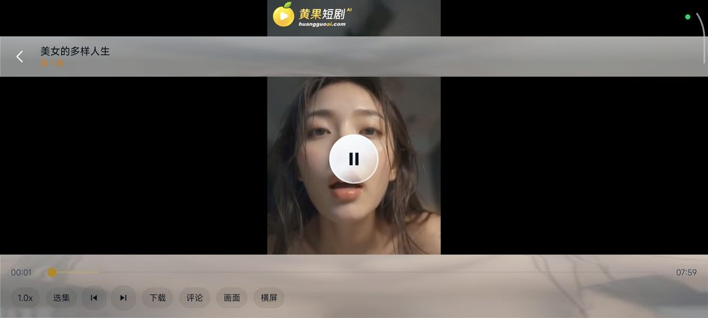

<div align="center">

# 黄果短剧 · Huangguo Pure

**一款以「液态玻璃」为设计语言的第三方短剧客户端**

原生 Android · 无广告 · 无推荐算法 · 深 / 浅双主题全适配

[](https://github.com/Zihium/Huangguo-Pure/releases)
[](LICENSE)
[]()
[]()

</div>

---

## 简介

Huangguo Pure 是一个第三方短剧聚合播放客户端，围绕液态玻璃视觉体系构建：玻璃控件对身后内容做真实像素采样，边缘折射、按压形变、拖动时光纹跟随手指变化。功能上覆盖浏览、搜索、播放、下载、收藏、评论、专题、博客、排行榜，并带检测更新、多线路切换等自维护能力。

## 截图预览

| 首页 | 发现 | 我的 |
|:---:|:---:|:---:|
|  |  |  |

### 液态玻璃 Dock

按压时玻璃胶囊放大到 78dp，上下各越出 64dp 栏体 7dp，胶囊里能看到被折射掰弯的栏体边框；横向拖动跟手，光纹随手指方向和速度变形，图标强调色跟着实时槽位切换。


| 播放器竖屏（悬浮控制条） | 播放器横屏（控制条铺满屏宽） |
|:---:|:---:|
|  |  |

## v1.1.0 相比 1.0.0 的更新

**Dock 玻璃栏重做**：底栏从自研 `LiquidGlassDrawable` 迁移到 Kyant0/AndroidLiquidGlass（Compose），按压 / 拖动的形变、折射、色散全部实时计算。胶囊放大越出栏体、栏体边框折射进胶囊、光纹跟手，都是这一版新增的观感。滑动帧率从掉帧调到 0% janky（50th 帧耗时 16ms 上下）。

**页面结构**：

- 「分类」更名「发现」，图标换成罗盘，专题与博客仍并在这一个入口里
- 顶栏与页面背景融合，去掉分隔线；首页搜索框移到标题右侧
- 「我的」页新增设置入口；外观、软件清理移入设置页

**设置中心（新增）**：外观三态（跟随系统 / 浅色 / 深色）、软件清理、线路切换、检测更新、自动检测更新开关、版本信息。线路切换从发布页拉取全部可用线路并发测速，按延迟排序，点击即切换。

**检测更新（新增）**：手动检测 + 每天首次启动自动检测（可关），更新弹窗和更新日志都是液态玻璃面板；数据源在 GitHub Releases，另配多个镜像发布页做防失效。

**深浅色跟随系统**：外观选「跟随系统」时，系统切换深浅色，应用在当前页面原地换色，不再跳回首页；设置页、关于页、专题页、标签页等全部二级页面同样生效。

**播放器**：全屏按钮改为「横屏」文字；横屏时顶栏与底部控制条铺满屏宽（左右零边距、直角贴边），竖屏保持悬浮卡片样式。

**其它**：视频详情页顶栏重排（返回键不再与状态栏重叠，去掉「含视频与评论」字样）；专题、标签、关于页顶栏避开状态栏；标签页返回键玻璃底色适配浅色主题；应用图标更换。

## 核心特色

### 🔷 液态玻璃，两套引擎各管一段

- **Dock 玻璃栏**：Kyant0/AndroidLiquidGlass（Compose）。Java 侧把玻璃矩形从原生视图树截成位图（3 倍降采样 + 自适应节流），Compose 侧做 vibrancy / blur / lens / 色散。采样泵覆盖触摸、惯性滑行、切页、启动四个窗口，玻璃里的背景逐帧跟着画面走。
- **播放器与弹层**：自研 `LiquidGlassDrawable`（BitmapMesh 折射 + 三通道色散 + 法线高光）。播放器顶栏 / 底栏每 300ms 采样视频帧，玻璃里透出的是正在播放的画面折射；菜单、弹窗、玻璃面板共用一套。

### 🌗 深色模式

深浅双主题全量手工适配，跟随系统切换时当前页面原地换色。深色下玻璃 tint、描边、文字、chip、进度条各自有一套取值，压在海报 scrim 上的文字保持恒白。

| 深色首页 | 深色我的 |
|:---:|:---:|
|  |  |

### 🎬 全手势播放器

| 手势 | 功能 |
|---|---|
| 双击左 / 右 1/3 画面 | 后退 / 快进 10 秒（带画面提示 + 震动反馈） |
| 双击中间 | 暂停 / 播放 |
| 左右横滑画面 | 拖动进度（低灵敏度，带时间预览） |
| 长按画面 | 2.0x 倍速加速 |
| 长按 + 上滑 | 锁定倍速；下滑恢复 |
| 单击中间 | 显示 / 隐藏控制层 |
| 底栏「画面」按钮 | 自适应原比例 / 铺满全屏 / 强制 16:9 / 强制 4:3 |

- 视频默认自适应原比例，不强制拉伸
- 倍速菜单 0.5x ~ 3.0x 六档，液态玻璃弹出面板
- 横屏控制条铺满屏宽，选集 / 下载 / 评论 / 画面设置都在一条里
- 断点续播，逐集记忆；音频焦点 / 插耳机自动暂停

### 📥 下载与数据

- HLS 流逐段下载，进度实时写在按钮上
- 按「剧名」归档到 `Download/Huangguo/<剧名>/`，支持批量删除
- 收藏 / 历史 / 点赞存本地 SQLite，登录后与站内账号互通

### ↔ 一体化滑动导航

一级页面（首页 → 发现 → 排行 → 我的）左右滑动直达；发现页内部的剧集 / 专题 / 博客分段滑到边界后继续滑动，接续切换到相邻一级页面。

### 🛠 自维护能力

- 检测更新：GitHub Releases + 多个镜像发布页，多源并发测速挑最快线路
- 线路切换：全部线路的延迟实时显示，一键切换
- 软件清理：缓存与下载文件管理

## 技术栈

| 项 | 实现 |
|---|---|
| 页面层 | Java（纯代码构建，无 XML 布局） |
| Dock 玻璃栏 | Compose + Kyant0/AndroidLiquidGlass（backdrop 1.0.6 / shapes 1.2.0） |
| 播放器与弹层玻璃 | Java 自研 `LiquidGlassDrawable`（BitmapMesh 折射 + 三通道色散） |
| 播放内核 | Media3 / ExoPlayer（HLS） |
| 最低支持 | Android 7.0（API 24）；玻璃效果完整体验需 Android 12+ |
| 本地存储 | SQLite（收藏 / 历史 / 点赞，含版本迁移） |
| 体积 | APK 约 1.9MB（arm64-v8a） |

## 构建

```bash
# 1. 用 Android Studio 打开项目，或命令行：
./gradlew assembleDebug

# 2. Release 签名：在本地 gradle.properties 配置（不要提交到仓库）：
# HG_STORE_FILE=../keystore/your.jks
# HG_STORE_PASS=xxx
# HG_KEY_ALIAS=xxx
# HG_KEY_PASS=xxx
./gradlew assembleRelease
```

## 目录结构

```
app/src/main/java/com/huangguo/pure/
├── MainActivity / HomePage / CategoryPage / RankPage / MinePage   # 一级页面
├── DetailActivity / TopicActivity / TopicPage / PostActivity      # 二级页面
├── SearchPage / SettingsActivity / AboutActivity                  # 设置与辅助页面
├── PlayerActivity                                                  # 全手势播放器
├── GlassHeader / GlassSurface / LiquidGlassDrawable / GlassDrawable # 玻璃引擎（Java 层）
├── DockBackdrop / Backdrop                                         # Dock 原生采样
├── glass/                                                          # Dock Compose 玻璃栏
│   ├── LiquidBottomTabs / LiquidBottomTab / GlassDockTabs / GlassBridge
│   ├── DampedDragAnimation / InteractiveHighlight / DockState
├── Update / Mirror / Api / Store                                   # 更新与数据
├── HlsDownloader / MediaSave / CleanHelper                         # 下载与清理
└── CommentBox / HtmlRich / PosterCard / PagedGrid                  # 内容组件
```

## License

[MIT](LICENSE) © 2026 Zihium
